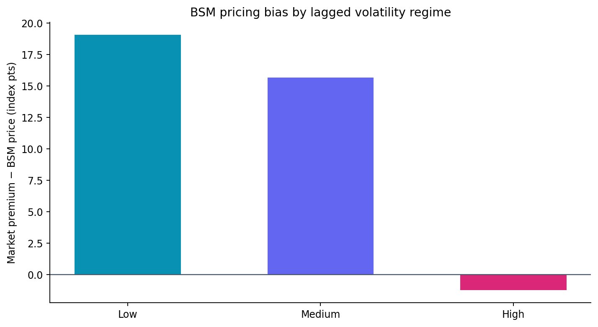
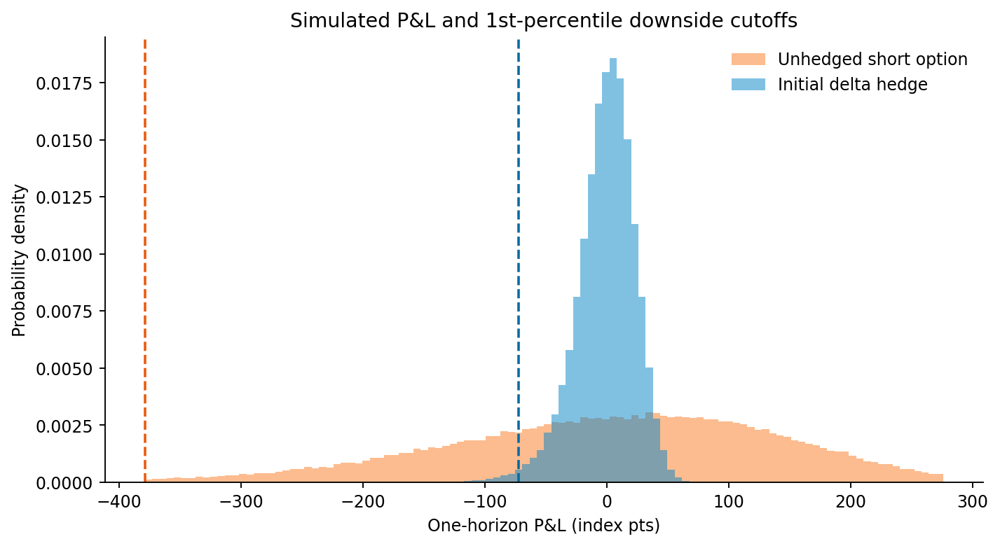
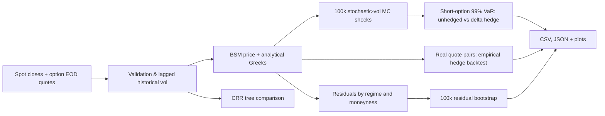

# NIFTY 50 Options: Pricing Models, Market Bias & Hedging VaR

**Reproducible Python research project** | Black–Scholes–Merton • Cox–Ross–Rubinstein • Greeks • 100k-path Monte Carlo • regime analysis • delta-hedging VaR

[](#tests--reproducibility) [](#quickstart) [](LICENSE)

This repository is a research-oriented implementation of an **option price modeling** project, originally framed around **NIFTY 50 European call and put options**. Its goal is to compare simple benchmark prices with market option premiums, study the effects of volatility regimes, and evaluate how a delta hedge changes the **99th-percentile short-option loss**.

> **Evidence and provenance:** The default demo is **100% synthetic**, clearly labeled, and uses synthetic prices on a NIFTY-like index scale. It is **not a live or historical NSE backtest**. A resume-reported **18% hedging VaR reduction is NOT established by this repo** without the original data, positions, hedge specification and backtest. This implementation independently calculates its own outcomes and never hard-codes 18%.

## Screenshots (seeded, *synthetic* run)

| Pricing residual bias by volatility regime | Short-call P&L: delta hedge vs unhedged |
|:--:|:--:|
|  |  |

### Included research workflow



## Quickstart

```bash
# Clone after publishing, or unzip the repository download
cd nifty50-options-pricing-risk

# Optional virtual environment
python -m venv .venv
# macOS / Linux: source .venv/bin/activate
# Windows PowerShell: .venv\Scripts\Activate.ps1

python -m pip install -e ".[dev]"
optionlab demo --n-paths 100000 --seed 42 --out results/demo
pytest
```

**Runs offline after dependencies have been installed.** Creates `results/demo/summary.json`, detailed quote-by-quote CSVs, and five PNG figures. Identical commands and versions should reproduce the seeded results. For a standalone module invocation, use `python -m optionlab demo` instead of `optionlab demo`.

Try the independent pricing calculator:

```bash
optionlab price --spot 23000 --strike 23000 --days 28 --rate 0.065 --vol 0.20 --dividend 0.012 --type CE
```

## Demonstration: example output (NOT real NSE)

| Metric | Seeded synthetic result |
|---|---:|
| Evaluated option observations | 700 |
| Option market-minus-BSM mean absolute error | 25.24 index points |
| Mean CRR-to-BSM absolute difference (201 steps) | 0.24 index points |
| Risk-neutral MC price, 100,000 paths | 613.68 index points |
| Analytical BSM price for the same example | 612.91 index points |
| Scenario 99% VaR, **unhedged short call** | 378.83 index points |
| Scenario 99% VaR, **initially delta-hedged short call** | 72.43 index points |
| Scenario 99% VaR reduction | **80.88% (synthetic scenario, not the resume's 18%)** |

See [`docs/demo_results.md`](docs/demo_results.md) for exact assumptions and interpretation. Synthetic data do not establish historical predictive accuracy, a real-trading strategy or a generalizable VaR improvement.

## Working with real NIFTY market data

The research pipeline supports **(a) normalized CSVs** or **(b) locally downloaded official NSE F&O bhavcopy archives**, in both historical legacy and UDiFF layouts. Market quotes and spot history must be sourced legitimately and aligned on quote date.

**Option A: prepared normalized quote file** (see [`examples/quotes_template.csv`](examples/quotes_template.csv)):

```bash
optionlab analyze \
  --quotes market_data/nifty_quotes.csv \
  --spot-history market_data/nifty_spot.csv \
  --n-paths 100000 \
  --out results/real_market
```

**Option B: official NSE legacy or UDiFF bhavcopy ZIP/CSV files** (daily archives; pass many days for regime analysis and historical hedge pairs):

```bash
optionlab analyze \
  --bhavcopy market_data/fo/*.zip \
  --spot-history market_data/nifty_spot.csv \
  --rate 0.065 --dividend 0.012 \
  --max-abs-log-moneyness 0.10 --max-days-to-expiry 60 \
  --n-paths 100000 \
  --out results/real_market
```

In PowerShell, provide the actual paths separated by spaces if glob expansion is not supported. The `--rate` and `--dividend` arguments are **assumptions**, not fetched historical rates; replace them with contemporaneous inputs to make a defensible study. The optional `--max-abs-log-moneyness` and `--max-days-to-expiry` settings restrict contract coverage to keep large multi-day files manageable; document any filtering when comparing results. The `--spot-history` CSV has exactly the columns `date,close`, and should contain at least **23 trading-date observations before the first quote** to populate the lagged volatility feature. The five-line example file merely documents the format: it is too short to estimate volatility.

**Normalized quote columns:**

| Field | Meaning |
|---|---|
| `quote_date`, `expiry` | ISO-like dates, e.g. `2025-06-02` |
| `strike`, `market_price`, `spot` | NIFTY index points; `spot` optional if spot-history supplied |
| `option_type` | `CE`, `PE` (also accepts `CALL`, `PUT`) |
| `historical_volatility` | Annualized decimal 21-session trailing HV; optional if spot-history supplied |
| `risk_free_rate`, `dividend_yield` | Annualized continuously compounded decimals; defaults are documented assumptions |
| `volume` | Optional; if present, zero-volume/stale option observations are removed |

NSE bhavcopy already contains option premiums and identifiers; an independent `date,close` spot series supplies the underlying, plus a lagged 21-return realized-vol estimate. **No raw NSE dataset is shipped with this repo.** Visit the [NSE derivatives historical reports](https://www.nseindia.com/all-reports-derivatives) and [NIFTY 50 derivatives specifications](https://www.nseindia.com/static/products-services/equity-derivatives-nifty50); observe applicable use and redistribution terms. Historical interest rates, dividend yields, lot sizes, and trading costs are not downloaded automatically.

## Research decisions

1. **No circular validation.** We price with **lagged realized volatility**, not implied volatility recovered from the option premium we are trying to explain. IV is calculated only as an extra descriptive field.
2. **European options.** BSM and CRR are priced under European exercise, including a dividend yield input. The tree is a numerical cross-check and is not independently calibrated to the market.
3. **Regime definitions.** Low, Medium, High volatility are within-sample terciles of *distinct quote-date* historical volatility, for **descriptive** (not predictive) comparison.
4. **100,000 is a path count, not a quote count.** MC simulates risk-neutral terminal payoffs (with paired antithetic variates); a separate 100k-resample bootstrap describes observed model residuals.
5. **VaR is a loss quantile.** A short European call is hedged initially with BSM delta. Under a specified stochastic-spot / correlated-IV scenario, report unhedged VaR, hedged VaR, expected shortfall and percentage reduction. Price/volatility shocks, carry and opening hedge transaction costs are modeled.
6. **Historical hedge-pair analysis is separate.** When multiple consecutive real quotes exist for identical `(expiry, strike, option_type)` contracts, compute a retrospective one-interval delta hedge P&L using the earlier quote's delta. A 100k paired bootstrap gives a *descriptive* historical VaR, with its effective observed sample size shown. The default demo intentionally has no such repeated contracts and flags that backtest **unavailable**.

More details, equations and caveats: [`docs/methodology.md`](docs/methodology.md).

## Output files

```
results/demo/
├── summary.json                 # metrics, assumptions, hedge parameters, provenance
├── synthetic_option_quotes.csv  # generated demo option premium data
├── synthetic_spot_history.csv   # generated spot close series
├── scored_quotes.csv            # premiums, BSM/CRR, IV, Greeks, per-quote errors
├── bias_by_regime.csv           # group sample sizes + signed bias/MAE/RMSE
├── bias_by_moneyness.csv
├── historical_hedge_pairs.csv   # empty unless repeated identical contracts
└── figures/
    ├── regime_bias.png
    ├── moneyness_mae.png
    ├── market_vs_model.png
    ├── pricing_error_scatter.png
    └── hedging_var.png
```

## Tests & reproducibility

```bash
pytest -q
# or the full run, using the same command as CI:
optionlab demo --n-paths 100000 --out results/ci-demo
```

GitHub Actions tests Python **3.10 and 3.12**, runs lint and `pytest`, and verifies a complete 100,000-path demo produced its expected artifacts. Tests cover textbook BSM values, put–call parity, finite-difference Greeks, CRR convergence, implied-volatility inversion, NSE adapter layouts, lagged-vol no-look-ahead, MC reproducibility and risk calculations.

## Repository map

```
src/optionlab/
  pricing.py        # BSM, vectorized BSM, CRR, IV, Greeks
  data.py           # input normalization, NSE adapters, lagged vol + regime features
  synthetic.py      # deterministic fake spot/option quotes for CI
  analysis.py       # cross-sectional market-vs-model diagnostics
  monte_carlo.py    # risk-neutral option MC, bootstrap, scenario + quote-pair VaR
  plots.py          # five reproducible charts
  cli.py            # demo / price / analyze commands
tests/               # unit and end-to-end tests
notebooks/           # optional exploratory research walkthrough
docs/                # derivations, limitations, interview walkthrough + sample charts
.github/workflows/  # automated tests
```

## Limits of the claim

A modeled *scenario* reduction of 80.88% on one short call says nothing definitive about the past **18% hedge VaR reduction** listed on a resume. To substantiate 18%, reproduce the original position set, quote dates, instrument/hedge (index or futures), rebalance schedule, sampling method, 99% VaR definition, transaction costs and baseline, then verify independently on historical records. This repo makes those assumptions visible and computes results from the provided data rather than adjusting a number to fit the resume.

For an interview-oriented 90-second explanation and common follow-ups, see [`docs/interview_walkthrough.md`](docs/interview_walkthrough.md).

---

**Research/educational use only.** Prices are in index points per option unit, **not INR per exchange lot**; multiply by historical lot size where appropriate. The example does not incorporate futures-index basis, full exchange trading costs, bid–ask execution, margin or liquidity slippage. No investment or trading recommendations.